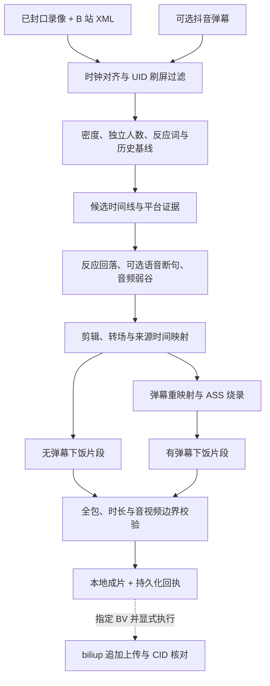

# Danmaku Highlight Pipeline

**从直播弹幕到可播放切片：候选发现、剪辑边界、双版本出片、媒体校验与可恢复上传。**

[](https://github.com/Assumine/danmaku-highlight-pipeline/actions/workflows/tests.yml)
[](LICENSE)

这里不只有流程图和评分公式。仓库提供可以直接执行的 Python 脚本，以及无需真实直播数据、无需账号即可跑通的合成样例。

它不是理解所有直播的语义模型：候选仍依赖观众语言、表情、独立账号和反应密度，换直播间前需要校准。项目不录制直播，也不会默认连接账号或投稿。

## 可运行的处理链



每个本地任务处理一份录像/XML。跨日归属、多 P 重排与替换另有纯函数适配层；本地入口不会自动执行这些编辑操作，也不包含生产环境的后台调度服务。

## 快速跑通

需要 **Python 3.9+、FFmpeg 和 ffprobe**。FFmpeg 需包含 `libx264`、AAC、`lavfi` 和 `libass`；Whisper 为可选依赖。

```powershell
git clone https://github.com/Assumine/danmaku-highlight-pipeline.git
cd danmaku-highlight-pipeline
python -m venv .venv
.\.venv\Scripts\Activate.ps1
pip install -e .

# 生成测试视频、虚构用户弹幕，并执行双版本出片
danmaku-pipeline --demo --workspace ./outputs/demo --preview-height 360

python -m unittest discover -s tests -q
```

Linux/macOS 激活虚拟环境使用 `source .venv/bin/activate`。

合成样例是一段 **120 秒的动态图案和正弦音轨**，中间加入虚构账号的集中笑声反应。输出是按候选边界剪好的两版成片，而不是简单复制原视频。CI 在 Python 3.9 和 3.13 上运行单元测试及 FFmpeg 样例，并要求产生两份成片。

FFmpeg 不在 `PATH` 时可指定：

```powershell
$env:FFMPEG_BIN = 'C:\ffmpeg\bin\ffmpeg.exe'
$env:FFPROBE_BIN = 'C:\ffmpeg\bin\ffprobe.exe'
```

## 处理自己的素材

```powershell
danmaku-pipeline --video ./input/session.mp4 --xml ./input/session.xml --workspace ./outputs/session
```

- `--douyin <目录> --room-url <本地直播间地址>`：按时间戳关联旁路弹幕。
- `--speech whisper`：语音边界精修，先安装 `pip install -e ".[speech]"`。
- `--preview-height 360`：低分辨率试跑；正式出片不传此参数。

只需要某个阶段，也可以使用：

```powershell
danmaku-program ./input/session.xml --no-clipboard --no-pause
danmaku-highlights --help
danmaku-audit --help
```

## 结果可以追溯

```text
workspace/
  records/<content-key>/
    job.json                  # 状态、输入/代码身份、输出哈希
    analysis/                 # 候选时间线、对齐报告、拒绝证据
    highlight-*/manifest.json # 最终边界、转场、来源时间映射
    montage.xml               # 映射到成片时钟的弹幕
    montage.ass               # 实际烧录的弹幕轨
  outputs/<content-key>/
    highlight-*.mp4           # 无弹幕版与有弹幕版
```

- **不是按总弹幕数机械选片**：独立账号、刷屏限制、反应类型与历史密度共同影响候选。
- **不是固定截取一段就结束**：边界结合群体反应、可选语音断句和音频变化，具体依据进入 manifest。
- **两版共用剪辑时间轴**：按转场偏移重映射源弹幕，不重新选择片段。ASS 使用顶部五条滚动轨，溢出丢弃并记录数量。
- **失败记录不被覆盖**：相同输入命令可接续，已完成输出检查哈希和媒体完整性，失败的剪辑尝试保留独立目录。
- **变更不静默复用**：输入、参数或代码改变会得到新的任务标识。已有成片被改动时停止，而不是直接当作可信缓存。

## 投稿需要显式同意

`danmaku-submit` 使用调用方本地安装的 biliup 1.2.6 和独立 Cookie 文件，只向**明确指定的 BV** 追加两版下饭片段。

```powershell
# 默认只展示计划，不访问账号、不发送请求
danmaku-submit ./outputs/session/records/<content-key>/job.json --target <BV> --biliup ./tools/biliup.exe --cookies ./private/cookies.json
```

检查目标后，加 `--execute` 才实际执行；`--wait-seconds 120` 可等待平台就绪。

追加前保存已存在 CID，追加后重新查询稿件。CLI 报错但新 CID 已出现时，不盲目重传；中断结果无法确认时停止等待人工核对。同名分 P 已存在且无对应回执，也不会自动覆盖。

**该入口不删除、重排或替换远端分 P。** 载荷构造见 [接口文档](docs/integration.md)，由部署方审核和执行。公开测试不会连接真实账号。

## 代码入口

| 模块 | 实际职责 |
|---|---|
| [pipeline.py](pipeline.py) | 本地端到端执行、双版本出片、合成样例与接续 |
| [pipeline_runtime.py](pipeline_runtime.py) | 原子 JSON 回执、SHA-256、跨平台进程锁 |
| [montage_danmaku.py](montage_danmaku.py) | 转场时钟映射、ASS 生成、轨道溢出控制 |
| [submission_worker.py](submission_worker.py) | 显式追加、CID 核对、中断去重和转码状态 |
| [program_rule_engine_v2.py](program_rule_engine_v2.py) | 滑动窗口、基线、多人反应和候选评分 |
| [dual_platform_program.py](dual_platform_program.py) | 录像时钟、双平台证据、稳定区间与候选融合 |
| [program_source_analysis.py](program_source_analysis.py) | 展示节目单主题及来源证据 |
| [highlight_editor.py](highlight_editor.py) | 边界精修、音频边缘、转场、来源角标与渲染 |
| [media_integrity.py](media_integrity.py) | 全包扫描、时间戳、时长与音视频边界检查 |
| [biliup_integration.py](biliup_integration.py) | biliup 命令、直播日、多 P 编辑载荷纯函数 |
| [program_extractor.py](program_extractor.py) / [program_audit.py](program_audit.py) | 节目单与只读审计命令行 |
| [danmaku_uid.py](danmaku_uid.py) | 账号身份有效性及短窗刷屏过滤 |

## 文档与边界

- [运行、接续与投稿](docs/running.md)
- [算法架构](docs/architecture.md)
- [录制与投稿接口](docs/integration.md)
- [换直播间前的校准](docs/customization.md)
- [误判、延迟与能力限制](docs/limitations.md)
- [安全与数据处理](SECURITY.md)

本仓库不包含真实弹幕、录像、生产账号、主播配置或历史稿件记录。生成的任务、日志和回执可能含本地路径、观众信息、BV/CID，必须留在本地。默认忽略规则不能替代发布前审查。

合成样例验证执行链，不证明算法理解了“好笑”；自动校验不能替代内容抽检、版权核对和平台规则审核。当前公开实现没有后台定时调度、自动录制、坏素材修复或跨日自动合并。

许可证：[MIT](LICENSE)。biliup、FFmpeg、faster-whisper 等外部工具使用各自许可证，需单独安装；本项目不包含这些工具代码，也不是其官方组件，见 [NOTICE.md](NOTICE.md)。
